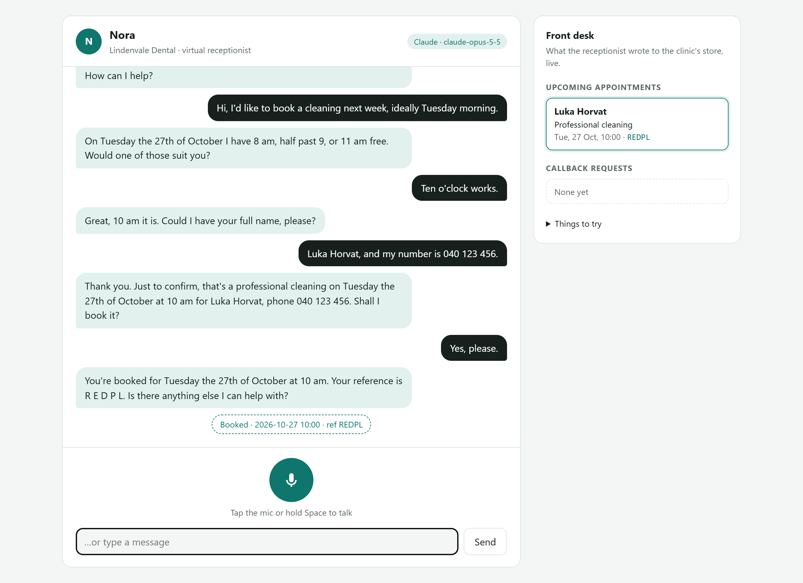
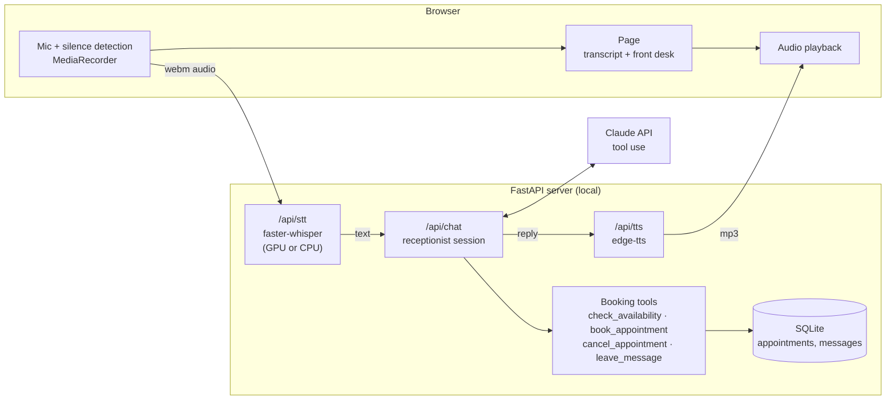

# Voice receptionist

A browser-based voice assistant that answers calls for a small business, books appointments into a local database, and talks back. The business is a fictional dental practice, **Lindenvale Dental**. The assistant is called **Nora**.

You talk, it listens (local Whisper speech-to-text), Claude works out the answer and calls booking tools, and the reply is spoken back (neural text-to-speech). A live "front desk" panel shows what was written to the store.



## What it does

- **Books appointments** that respect opening hours, how long each service takes, and existing bookings. It won't double-book, book in the past, or book too far ahead.
- **Cancels** a booking, but only when the reference and the phone number match.
- **Answers questions** from a short knowledge file: hours, prices, parking, insurance, children, payment.
- **Logs callback requests** for anything it can't handle.
- **Escalates danger signs** (swelling that affects breathing or swallowing, heavy bleeding) by telling the caller to call 112.
- **Talks like a phone call**: short replies, times said the natural way, booking references spelled out letter by letter, and one question at a time.

## Sample conversations

These are real replies from a run with Claude (`claude-opus-5-5`, effort `low`). Each turn took 1.3 to 5 seconds.

**Booking**
> **Caller:** Hi, I'd like to book a cleaning next week, ideally Tuesday morning.
> **Nora:** On Tuesday the 27th of October I have 8 am, half past 9, or 11 am free. Would one of those suit you?
> **Caller:** Ten o'clock works.
> **Nora:** Great, 10 am it is. Could I have your full name, please?
> **Caller:** Luka Horvat, and my number is 040 123 456.
> **Nora:** Thank you. Just to confirm, that's a professional cleaning on Tuesday the 27th of October at 10 am for Luka Horvat, phone 040 123 456. Shall I book it?
> **Caller:** Yes, please.
> **Nora:** You're booked for Tuesday the 27th of October at 10 am. Your reference is R E D P L. Is there anything else I can help with?

**Questions**
> **Caller:** Are you open on Friday afternoon? And is there parking?
> **Nora:** On Friday we're only open until 2 pm, so not in the afternoon. There's free parking behind the building, with the entrance from Birch Lane. Would you like me to check for a Friday appointment?

**Cancelling**
> **Caller:** I need to cancel my appointment, the reference is R E D P L.
> **Nora:** Thanks, I have the reference R E D P L. What phone number is the booking under?
> **Caller:** 040 123 456
> **Nora:** All done, Luka. I've cancelled your cleaning on Tuesday the 27th of October at 10 am. Would you like to book a new time?

**Callback request**
> **Caller:** Can someone call me back about whether my insurance covers whitening? I'm Maja Kos, 041 222 333.
> **Nora:** I can answer that now, Maja: insurance never covers whitening at our clinic. It costs 220 euros. Would you still like a staff member to call you back?
> **Caller:** Yes.
> **Nora:** Done, Maja. I've left a message, and a staff member will call you back on 041 222 333. We're closed today, so it will probably be Monday. Is there anything else?

**Danger sign**
> **Caller:** Also my cheek is swelling up and it's getting hard to swallow.
> **Nora:** Swelling that makes it hard to swallow is a danger sign. Please hang up and call 112 right now.

## Architecture



| Piece | File | Notes |
|---|---|---|
| Booking rules and store | [`app/booking.py`](app/booking.py) | Opening hours, service lengths, overlap checks, 30-minute lead time, 60-day horizon, references without the easily confused 0/O and 1/I. SQLite. |
| Tools | [`app/tools.py`](app/tools.py) | Strict JSON-schema tools. Broken rules come back to the model as error codes instead of exceptions, so it can recover ("that time is taken, how about…"). |
| Brain | [`app/assistant.py`](app/assistant.py) | `ClaudeReceptionist`: a tool-use loop with an append-only history, a voice-specific system prompt, refusal handling and server-side fallback. `ScriptedReceptionist`: a rule-based offline fallback (see below). |
| Business data | [`app/clinic.json`](app/clinic.json), [`app/knowledge.md`](app/knowledge.md) | Hours, services and prices; front-desk notes. Swap these to rebrand it for another business. |
| Speech | [`app/speech.py`](app/speech.py) | faster-whisper `small.en` tries CUDA first and falls back to CPU int8. edge-tts neural voice. If server TTS fails, the page uses the browser's own voice. |
| Web page | [`app/static/`](app/static) | Plain HTML/CSS/JS with no build step. Tap the mic or hold Space; recording stops after 1.2 s of silence. Tapping again interrupts the reply. Typing works too. Light and dark themes. |

**Offline mode.** Without an API key the app still runs end to end with `ScriptedReceptionist`: keyword intents plus slot filling (service, day, time, name, phone). It is much less flexible than Claude, but anyone can try the voice loop and the booking store without credentials. The badge in the header shows which brain is answering.

## Run it

You need Python 3.10 or newer. A CUDA GPU is optional (Whisper falls back to CPU).

```bash
python -m venv .venv
.venv\Scripts\activate          # macOS/Linux: source .venv/bin/activate
pip install -r requirements.txt
copy .env.example .env          # macOS/Linux: cp .env.example .env, then add your ANTHROPIC_API_KEY
uvicorn app.main:create_app --factory --port 8642
```

Open <http://localhost:8642>, click **Start call** and allow the microphone. The first transcription downloads the Whisper model (about 480 MB for `small.en`) and loads it. After that it takes about 0.4 s on a GPU.

Settings live in `.env` (see [`.env.example`](.env.example)): `CLAUDE_MODEL`, `CLAUDE_EFFORT`, `RECEPTIONIST_MODE` (`auto` / `claude` / `offline`), `WHISPER_MODEL`, `WHISPER_DEVICE`, `TTS_VOICE` and `DB_PATH`.

**Where data goes.** Audio is transcribed on your machine. Transcribed text goes to the Anthropic API. Reply text goes to Microsoft's Edge read-aloud service for speech. Bookings stay in `data/receptionist.db`.

## Tests

```bash
python -m pytest -q
```

There are 37 tests. They cover the booking rules (hours, overlaps, lead time, closed days, horizon, validation, cancelling and slot release, persistence, readable references), the date and time parsing for spoken phrases, offline conversations from start to finish, the HTTP API, and the Claude tool loop with a fake client: tools get run, thinking blocks are passed back unchanged, and a refusal rolls back the turn. The tests use a fixed clock and make no network calls.

## Making it real

This is a demo. A production version would add:

- **Phone line:** Twilio or SIP media streams in place of the browser mic.
- **Streaming:** streaming STT, LLM and TTS for sub-second replies.
- **Calendar:** sync with the clinic's real calendar or practice-management system.
- **SMS confirmations:** a text to the caller after each booking.
- **Admin and data:** authentication on the admin endpoints, and handling of patient data under GDPR.
