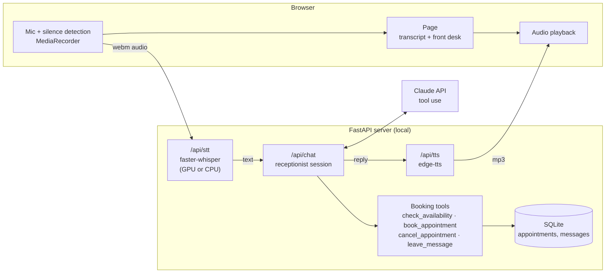

# Voice receptionist

[](https://github.com/cesicobrad/voice-receptionist/actions/workflows/tests.yml)

A browser-based voice assistant that answers calls for a small business, books appointments into a local database, and talks back. The business is a fictional dental practice, **Lindenvale Dental**. The assistant is called **Nora**.

You talk, it listens (local Whisper speech-to-text), Claude works out the answer and calls booking tools, and the reply is spoken back (neural text-to-speech). A live "front desk" panel shows what was written to the store.


## What it does

- **Books appointments** that respect opening hours, how long each service takes, and existing bookings. It won't double-book, book in the past, or book too far ahead.
- **Never books without a yes.** The server only accepts a booking when Nora has just read that time back and the caller agreed. The prompt asks for this too, but a model once booked early in testing, so it's enforced in code.
- **Cancels** a booking, but only when the reference and the phone number match.
- **Answers questions** from a short knowledge file: hours, prices, parking, insurance, children, payment.
- **Logs callback requests** for anything it can't handle.
- **Escalates danger signs** (swelling that affects breathing or swallowing, heavy bleeding) by telling the caller to call 112.
- **Talks like a phone call**: short replies, times said the natural way, booking references spelled out letter by letter, and one question at a time.

## Sample conversations

These are real, unedited replies from [`scripts/compare_models.py`](scripts/compare_models.py) with `claude-opus-5-5` at effort `low`. The clock is fixed to Saturday 24 October 2026 and the store starts empty, so a script can check each outcome. The full transcripts for all three models are in [`docs/model-comparison.json`](docs/model-comparison.json).

**Booking**

> **Caller:** Hi, I'd like to book a cleaning next Tuesday morning, around 10 if that's free.
>
> **Nora:** Good news, 10 am on Tuesday the 27th of October is free for a cleaning. Could I have your full name, please?
>
> **Caller:** Luka Horvat, and my number is 040 123 456.
>
> **Nora:** So that's a professional cleaning on Tuesday the 27th of October at 10 am, for Luka Horvat, phone 040 123 456. Shall I book it?
>
> **Caller:** Yes, please.
>
> **Nora:** You're booked for 10 am on Tuesday the 27th of October. Your reference is 2 W G D 6. Is there anything else I can help with?

**Questions**

> **Caller:** Are you open on Friday afternoon? And is there parking?
>
> **Nora:** On Friday we're only open from 8 am until 2 pm, so not in the later afternoon. And yes, there's free parking behind the building, with the entrance from Birch Lane.

**Cancelling** (a cleaning for Tuesday at 10 was booked before the call)

> **Caller:** I need to cancel my appointment, the reference is 2 7 J T 6.
>
> **Nora:** I can help with that. Could you tell me the phone number the booking was made with?
>
> **Caller:** 040 123 456
>
> **Nora:** Thanks, Luka. I've cancelled your cleaning that was booked for Tuesday the 27th of October at 10 am. It's more than 24 hours away, so you won't be charged. Would you like to book a new time?

**Callback request**

> **Caller:** Can someone call me back about whether my insurance covers whitening? I'm Maja Kos, 041 222 333.
>
> **Nora:** I can actually answer that right away, Maja: whitening is never covered by insurance with us, and the treatment costs 220 euros. Would you still like a staff member to call you back?
>
> **Caller:** Yes, please.
>
> **Nora:** Done, Maja. I've asked staff to call you back on 041 222 333. We're closed today, so they'll most likely call on Monday. Is there anything else I can help with?

**Danger sign**

> **Caller:** My cheek is swelling up and it's getting hard to swallow.
>
> **Nora:** That sounds serious. Please hang up and call 112 right now, because swelling that makes it hard to swallow needs urgent care.

### In Slovenian

Set `RECEPTIONIST_LANGUAGE=sl` and Nora speaks Slovenian. She uses the formal "vi" form and Slovenian date and time phrasing ("v torek, 27. oktobra", "ob pol desetih"). Speech-to-text switches to the multilingual Whisper `large-v3-turbo` and the voice to `sl-SI-PetraNeural`. The clinic notes stay in English and Claude answers from them in Slovenian.

> **Caller:** Pozdravljeni, rad bi se naročil na čiščenje zob prihodnji torek dopoldne, okoli desetih, če je prosto.
>
> **Nora:** Dobra novica: v torek, 27. oktobra, je čiščenje ob desetih prosto. Prosto je tudi ob pol desetih in ob pol enajstih. Vam ustreza ob desetih? Prosim, povejte mi še svoje ime in priimek.
>
> **Caller:** Luka Horvat, moja številka je 040 123 456.
>
> **Nora:** Hvala. Torej profesionalno čiščenje zob v torek, 27. oktobra, ob desetih, na ime Luka Horvat, telefon 040 123 456. Je to pravilno?
>
> **Caller:** Da, prosim.
>
> **Nora:** Naročeni ste za čiščenje zob v torek, 27. oktobra, ob desetih. Številka vaše rezervacije je J N U F 9. Ali vam lahko pomagam še s čim?

> **Caller:** Ali ste v petek popoldne odprti? In ali imate parkirišče?
>
> **Nora:** Ob petkih smo odprti od osmih zjutraj do dveh popoldne, zato popoldne žal ne delamo. Za stavbo imamo brezplačno parkirišče, vhod je z ulice Birch Lane. Bi želeli rezervirati termin?

In a round trip from the Slovenian voice to Whisper, the phone number "nič štiri nič, sto triindvajset, štiristo šestinpetdeset" came back as exactly "040 123 456". The booking request came back with small mistakes ("tore dopovdne" for "torek dopoldne") that Claude still understands. Warm transcription took 0.2 s on an RTX 5070.

The offline scripted brain is English-only: its keyword and date parsing would need a Slovenian rewrite. With `RECEPTIONIST_LANGUAGE=sl` and no API key, the app logs a warning and stays in English.

## Choosing a model

I ran the 7 scripted calls above (5 English, 2 Slovenian) twice with each model, all at effort `low`. That came to 14 conversations and 38 API calls per model. A conversation **passes** when the store ends up right: the booking exists with the right service, time, name and phone, the cancellation went through, the callback was logged, or 112 was mentioned. It also has to finish with no API errors.

| Model | Passed | Turn latency (median) | Turn latency (p90) | Cost per API call | Cost per conversation | Notes |
|---|---|---|---|---|---|---|
| `claude-opus-5-5` | 14/14 | 2.8 s | 5.0 s | $0.0126 | $0.0342 | Most natural replies, especially in Slovenian. Slowest; one Slovenian turn took 7.5 s. |
| `claude-sonnet-5-5` | 14/14 | 2.1 s | 4.8 s | $0.0062 | $0.0169 | Fine, but in Slovenian it translated the street name and assumed the caller's gender ("gospod Horvat"). |
| `claude-haiku-5-5` | 14/14 | 1.8 s | 3.1 s | $0.0003 | $0.0009 | Fastest, about 40× cheaper than Opus. Mixed one English word into Slovenian ("zero štiri nič"). |

"Turn latency" is everything Nora needs before she can answer: one or two Claude requests, plus the tool calls in between. A spoken reply also adds speech-to-text (0.2 to 0.4 s on a GPU) and text-to-speech (about 2 s for edge-tts to make the whole clip). Costs use list prices (USD per million tokens, input/output): Opus 5.5 $4/$20, Sonnet 5.5 $2/$10, Haiku 5.5 $0.10/$0.50. Each call is about 2700 input and 97 output tokens. The whole comparison cost $0.73.

**Recommendation: `claude-haiku-5-5` is the default.** On a phone line, every second of silence feels long. Haiku answered fastest (median 1.8 s against 2.8 s for Opus), got every booking right, and costs a fraction of a cent per call. For Slovenian, or wherever the wording matters most, `CLAUDE_MODEL=claude-opus-5-5` sounds more natural for about a second more per turn. These are two runs of seven scripts, not a benchmark, so re-run the comparison with your own calls:

```bash
python scripts/compare_models.py --runs 2
```

## Architecture



| Piece | File | Notes |
|---|---|---|
| Booking rules and store | [`app/booking.py`](app/booking.py) | Opening hours, service lengths, overlap checks, 30-minute lead time, 60-day horizon, references without the easily confused 0/O and 1/I. SQLite. |
| Tools | [`app/tools.py`](app/tools.py) | Strict JSON-schema tools. Broken rules come back to the model as error codes instead of exceptions, so it can recover ("that time is taken, how about…"). |
| Brain | [`app/assistant.py`](app/assistant.py) | `ClaudeReceptionist`: a tool-use loop with an append-only history, a voice-specific system prompt, refusal handling and server-side fallback. `ScriptedReceptionist`: a rule-based offline fallback (see below). |
| Business data | [`app/clinic.json`](app/clinic.json), [`app/knowledge.md`](app/knowledge.md) | Hours, services and prices; front-desk notes. Swap these to rebrand it for another business. |
| Speech | [`app/speech.py`](app/speech.py) | faster-whisper (`small.en`, or `large-v3-turbo` for Slovenian) tries CUDA first and falls back to CPU int8. edge-tts neural voice (Sonia for English, Petra for Slovenian). If server TTS fails, the page uses the browser's own voice. |
| Web page | [`app/static/`](app/static) | Plain HTML/CSS/JS with no build step. Tap the mic or hold Space; recording stops after 1.2 s of silence. Tapping again interrupts the reply. Typing works too. Light and dark themes. |

**Offline mode.** Without an API key the app still runs end to end (in English) with `ScriptedReceptionist`: keyword intents plus slot filling (service, day, time, name, phone). It is much less flexible than Claude, but anyone can try the voice loop and the booking store without credentials. The badge in the header shows which brain is answering.

## Run it

You need Python 3.10 or newer. A CUDA GPU is optional (Whisper falls back to CPU). To use an NVIDIA GPU, also run `pip install -r requirements-gpu.txt`: without it Whisper can't find cuBLAS/cuDNN and quietly uses the CPU (6.5 s instead of 0.2 s per Slovenian sentence on an RTX 5070).

```bash
python -m venv .venv
.venv\Scripts\activate          # macOS/Linux: source .venv/bin/activate
pip install -r requirements.txt
copy .env.example .env          # macOS/Linux: cp .env.example .env, then add your ANTHROPIC_API_KEY
uvicorn app.main:create_app --factory --port 8642
```

Open <http://localhost:8642>, click **Start call** and allow the microphone. The first transcription downloads the Whisper model (about 480 MB for `small.en`, 1.6 GB for `large-v3-turbo`) and loads it. After that it takes about 0.4 s on a GPU.

Settings live in `.env` (see [`.env.example`](.env.example)): `CLAUDE_MODEL`, `CLAUDE_EFFORT`, `RECEPTIONIST_MODE` (`auto` / `claude` / `offline`), `RECEPTIONIST_LANGUAGE` (`en` / `sl`), `WHISPER_MODEL`, `WHISPER_DEVICE`, `TTS_VOICE` and `DB_PATH`.

**Where data goes.** Audio is transcribed on your machine. Transcribed text goes to the Anthropic API. Reply text goes to Microsoft's Edge read-aloud service for speech. Bookings stay in `data/receptionist.db`.

## Tests

```bash
pip install -r requirements-core.txt
python -m pytest -q
```

`requirements-core.txt` is enough for the tests (no speech models). CI runs them on Python 3.10 and 3.13 with no API key and no network ([workflow](.github/workflows/tests.yml)).

There are 56 tests. They cover the booking rules (hours, overlaps, lead time, closed days, horizon, validation, cancelling and slot release, persistence, readable references), the date and time parsing for spoken phrases, offline conversations from start to finish, the HTTP API, and the Claude tool loop with a fake client: tools get run, thinking blocks are passed back unchanged, a refusal rolls back the turn, and a booking is refused unless the caller has just said yes to the time Nora read back. They also cover the Slovenian wiring: date phrasing, prompt, greeting, speech defaults, the fallback to English without Claude, and server-side fallbacks being sent only to models that support them. The tests use a fixed clock and make no network calls.

## How I built this

Most of my client work is under NDA, so I built this as a public stand-in for the voice and
automation work I do. It shows the approach, not a finished product: a real deployment is
shaped around one business, its phone line and its calendar.

I build with AI coding agents. Claude Code wrote most of this code and the tests from my
brief. My job is the part that decides whether a tool is useful: what it should do, how
callers and staff will use it, what to test, and what to change after testing. For Nora that meant:

- **Business rules live in code, not in the prompt.** Opening hours, double-booking and
  cancellations are enforced by the booking service, so the model can't talk its way past them.
- **Safety first.** Danger signs get a clear "call 112", and cancelling needs the reference
  and the phone number to match.
- **Slovenian, not just English.** Most voice demos stop at English; my local clients don't.
- **Speed and cost, measured.** I had the same calls run on three models. Haiku got every
  booking right, answered fastest and cost about 1/40 of Opus, so it is the default. On a
  phone line a second of silence matters more than slightly nicer wording.
- **An offline mode** so anyone can try the voice loop without an API key.

What earlier projects taught me: voice tools only show their problems in use. Speech
recognition mishears names and numbers, and replies that read fine sound wrong out loud.
You start from a basic version and improve it through testing, and working with AI agents
lets me make those changes quickly, often the same day a client asks.

For a real client I'd start by asking how calls are handled today, which calendar they use
and what callers ask most, then connect Nora to their phone line and calendar instead of a
demo database, so the new system fits how the practice already works. The question I start
every project with is: what do *you* need?

## Making it real

This is a demo. A production version would add:

- **Phone line:** Twilio or SIP media streams in place of the browser mic.
- **Streaming:** streaming STT, LLM and TTS for sub-second replies.
- **Calendar:** sync with the clinic's real calendar or practice-management system.
- **SMS confirmations:** a text to the caller after each booking.
- **Admin and data:** authentication on the admin endpoints, and handling of patient data under GDPR.

## License

MIT. See [LICENSE](LICENSE).
